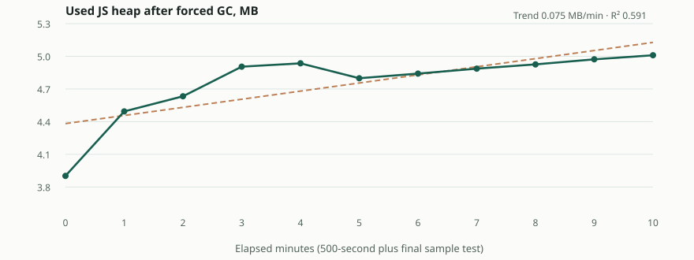

# Iteration 5 — ten-minute memory evidence

Source: [Actions #42022735338](https://github.com/markofornoliak/tykora/actions/runs/42022735338), SHA `43045e5b8541b4f495810c3d1ebeb8660bd01050`, Chromium 156.0.8078.4, forced GC via CDP every 60 seconds, full 4,000-character continuing session.

| Minute | Used JS heap (MB) | DOM element count | Typed graphemes |
|---|---:|---:|---:|
| 0 | 3.902 | 514 | 0 |
| 1 | 4.494 | 516 | 400 |
| 2 | 4.633 | 516 | 800 |
| 3 | 4.905 | 516 | 1200 |
| 4 | 4.936 | 516 | 1600 |
| 5 | 4.799 | 516 | 2000 |
| 6 | 4.841 | 516 | 2400 |
| 7 | 4.887 | 516 | 2800 |
| 8 | 4.926 | 516 | 3200 |
| 9 | 4.973 | 516 | 3600 |
| 10 | 5.010 | 516 | 4000 |

**Ordinary least squares slope: +0.075 MB/min (R²=0.591).** Start 3.902 MB, finish 5.010 MB; difference +1.108 MB. DOM elements 514→516. A positive trend exists, but the scenario keeps 4,000 input attempts in memory; **this is not proof of a leak**. To assess retention growth, repeat equal-length sessions with full reset and compare GC-stabilized heap plateaus; that experiment is outstanding. There is no physical device evidence.

Graph shows measured data and an OLS line; neither is predictive or a leakage diagnosis.
